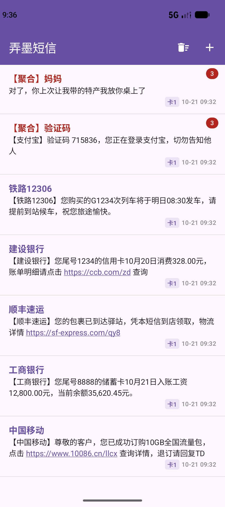
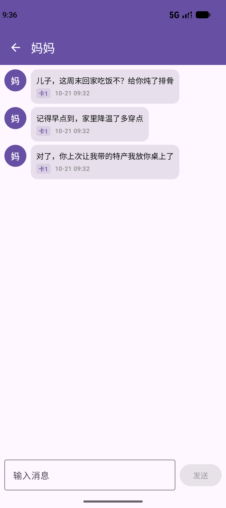
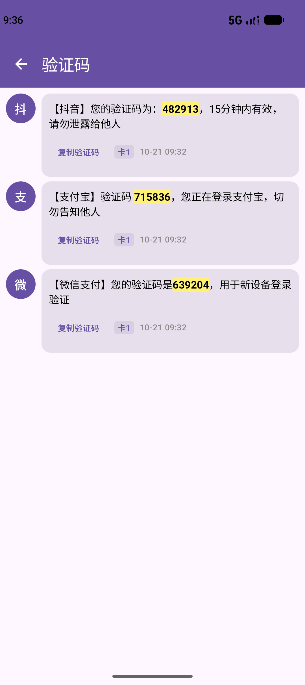
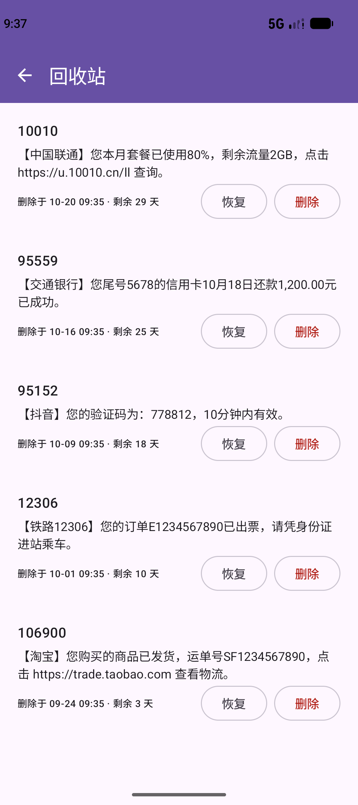
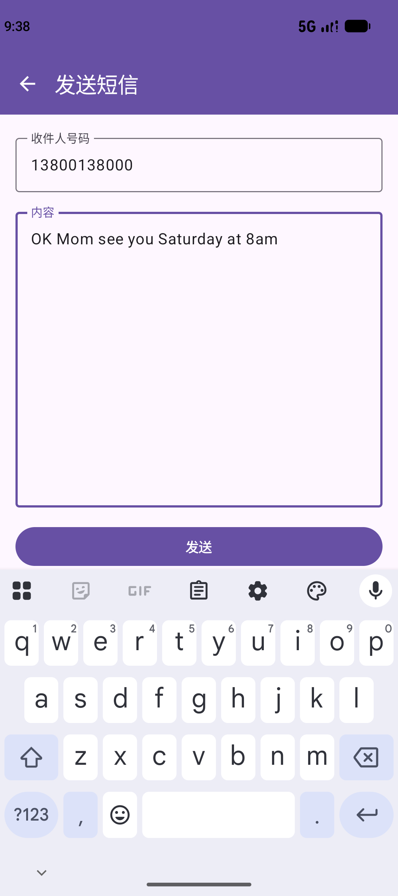
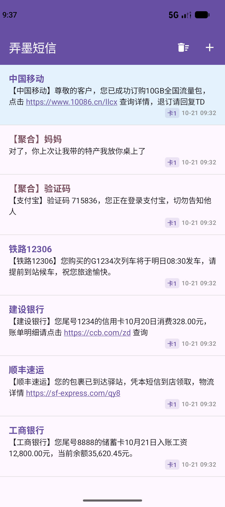
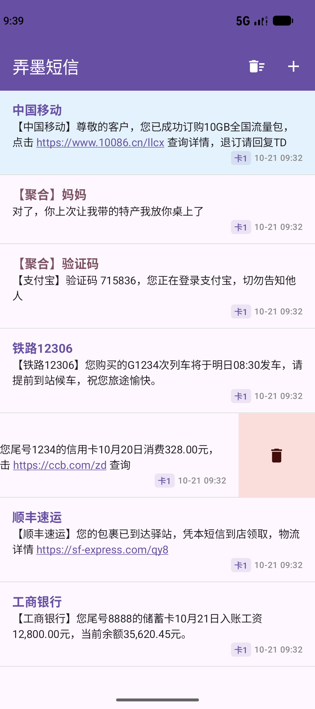

# 弄墨短信 · ink-sms

一个用 **Kotlin + Jetpack Compose** 编写的 Android 短信（SMS）应用，作为系统默认短信应用的个人替代客户端。对已接收 / 已发送的文本短信做会话级聚合展示，并对**验证码、服务号链接、联系人**等做了专门的解析与交互优化。

> 个人自用、不上架的纯文本短信 App，不处理 MMS。

---

## 功能特性

- **会话聚合列表**：同一号码归并为一条会话，显示最新消息摘要、时间、未读数量角标。
- **验证码自动聚合**：含「验证码 / 校验码 / OTP / captcha …」等明确关键词的短信自动归入「验证码」会话；自动提取并**黄色高亮**验证码数字，提供「复制验证码」一键复制；验证码短信 **1 天后自动清理**（副本进入回收站）。
- **服务号名称解析**：内置离线公共号码库 `assets/public_numbers.json`（银行 / 运营商 / 快递 / 政务等），把 `10086`、`95588`、`95338` 等显示为友好名称；未命中时回退到正文签名 `【…】` 兜底，再回退到原号码。
- **联系人名称**：授权 `READ_CONTACTS` 后优先显示通讯录名称（可选增强，不授权也能正常使用）。
- **链接识别**：正文中的 URL 自动识别并可点击跳转（基于 `LinkAnnotation`）。
- **左滑删除 / 回收站**：列表项左滑删除会话、详情页左滑删除单条消息，副本写入本地 Room 回收站；回收站支持「恢复」写回系统短信库或「永久删除」，**超 30 天自动清理**。
- **长按置顶**：长按会话可置顶，置顶会话排到列表最前并高亮。
- **消息详情交互**：双击气泡全屏放大查看；长按气泡复制文本；验证码会话内的消息可「移出验证码列表」。
- **发送短信**：详情页底部回复 / 列表页 `+` 新建发送，多 SIM 卡可选。
- **默认短信应用四件套**：`SmsReceiver`（接收）、`SENDTO` 入口、占位 `MmsReceiver` / `HeadlessSmsSendService`，满足系统默认短信应用要求。

---

## 截图

| 会话列表首页 | 会话详情（联系人） |
| --- | --- |
|  |  |

| 验证码聚合 | 回收站 |
| --- | --- |
|  |  |

| 发送页面 | 置顶后首页 | 左滑删除 |
| --- | --- | --- |
|  |  |  |

更完整的界面与交互说明见 [`docs/UI交互说明.md`](docs/UI交互说明.md)。

---

## 技术栈

| 分类 | 选型 |
| --- | --- |
| 语言 | Kotlin 2.2.10 |
| UI | Jetpack Compose（Material 3，BOM 2026.02.01） |
| 架构 | MVVM + Repository，单向数据流（`StateFlow` + `collectAsStateWithLifecycle`） |
| 依赖注入 | Hilt 2.60.1 |
| 本地存储 | Room 2.7.1（回收站副本） |
| 导航 | Navigation Compose 2.9.8 |
| 构建 | Android Gradle Plugin 9.1.1，KSP 2.2.10 |
| 最低 / 目标 / 编译 SDK | minSdk 24 / targetSdk 36 / compileSdk 36 |

## 项目结构

```
app/src/main/java/com/ink/sms/
├── MainActivity.kt            # 入口 Activity，未就绪时显示设置卡片
├── SmsApplication.kt          # Application，Hilt 入口
├── data/                      # SmsRepository、Room（回收站）、实体、数据源
├── di/                        # Hilt 模块
├── feature/                   # 各页面（列表 / 详情 / 发送 / 回收站）
├── receiver/                  # SmsReceiver、MmsReceiver、CopyCodeReceiver、BootReceiver
├── service/                   # HeadlessSmsSendService、KeepAliveService
├── util/                      # 验证码提取、链接、签名、联系人解析等
└── notification/、badge/      # 通知 / 桌面角标
```

---

## 设为默认短信应用（重要）

本应用要真正收发短信，必须在系统中**设为默认短信应用**（设置 → 应用 → 默认应用 → 短信应用）。否则只能读取已存在的短信、无法接收与发送新短信。

> ⚠️ 设为默认短信应用后，系统的短信收发将由本应用接管；`MmsReceiver` 与 `HeadlessSmsSendService` 目前仅为占位，不处理 MMS / 通知栏快捷回复。

## 权限说明

| 权限 | 用途 | 是否必需 |
| --- | --- | --- |
| `READ_SMS` / `RECEIVE_SMS` | 读取 / 接收短信 | 必需 |
| `SEND_SMS` | 发送短信 | 必需 |
| `READ_CONTACTS` | 解析联系人名称 | 可选增强 |
| `READ_PHONE_STATE` | 识别 SIM 卡用于发送 | 可选 |
| `POST_NOTIFICATIONS` | 新短信通知 | 可选 |
| 厂商角标权限（如 OPPO `BADGE_COUNT_WRITE`） | 桌面未读角标 | 可选 |

---

## 开源协议

本项目采用 **MIT License**，详见仓库根目录 [`LICENSE`](LICENSE) 文件。

Copyright (c) 2026 linq8261

---

## 免责声明

本项目为个人学习 / 自用目的开发，按现状提供，不保证适配所有机型与 ROM。设置为默认短信应用前请确认已备份重要短信。
